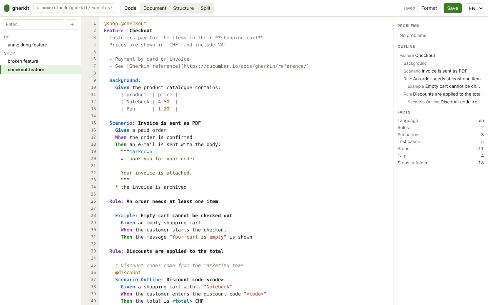
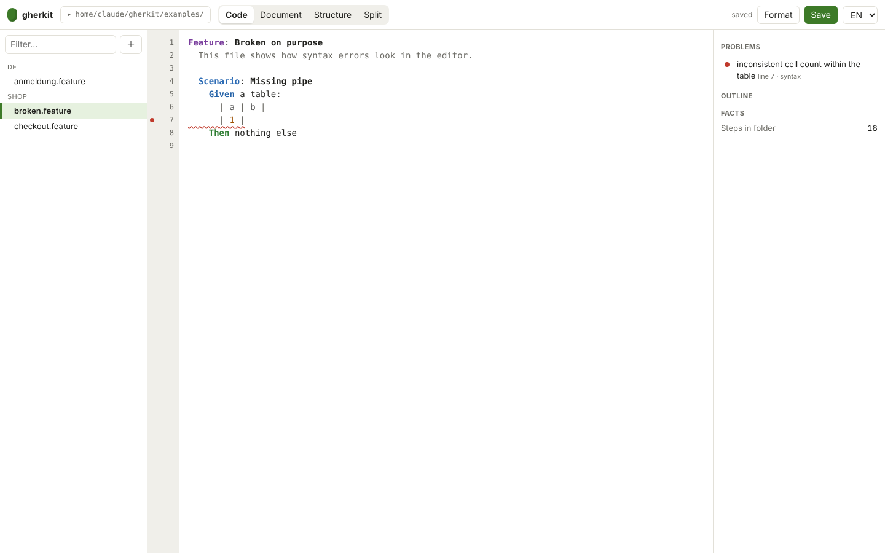
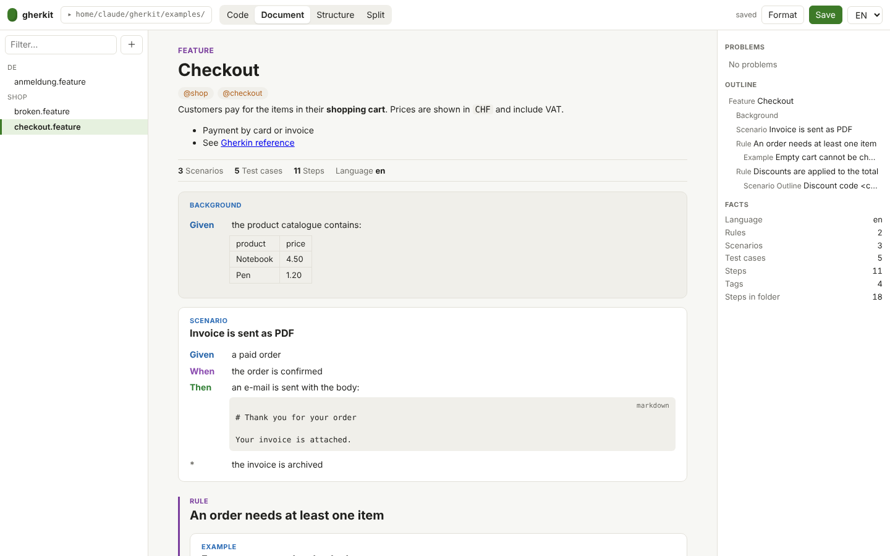
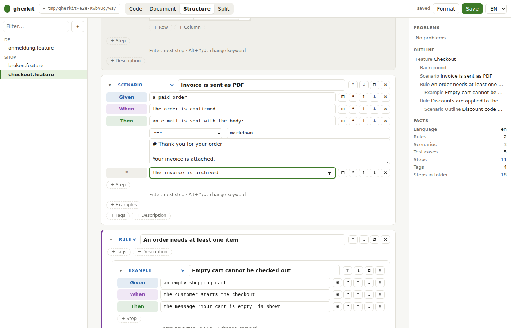
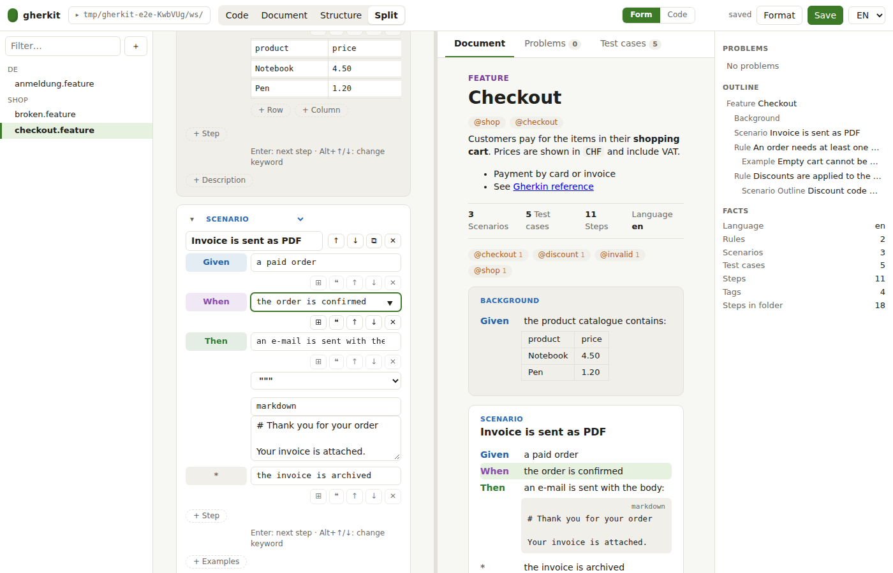
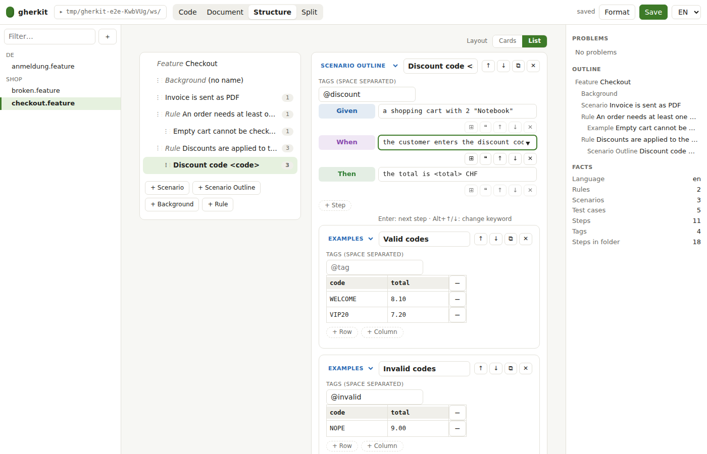
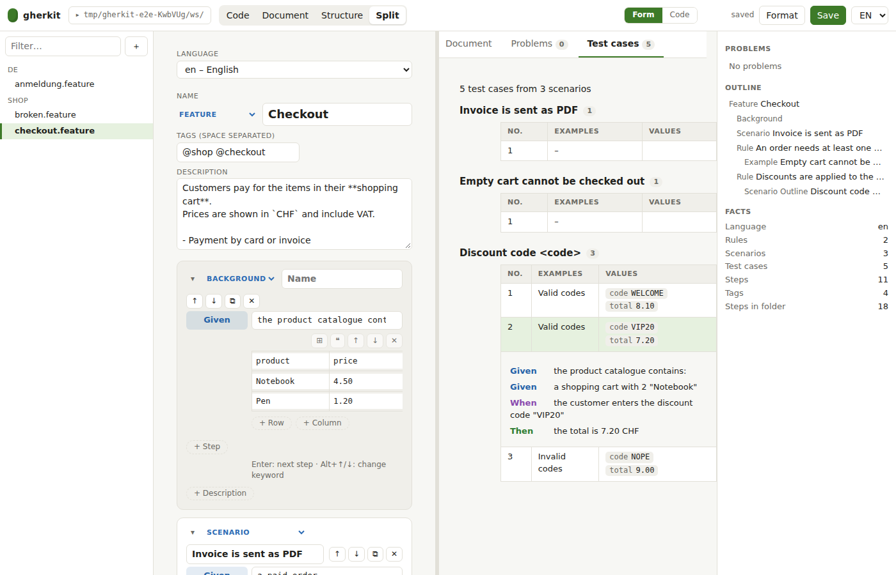

# Editor variants (decided for M1, see [ADR 0007](adr/0007-editor-variants-m1.md))

`gherkit edit [folder]` contains four variants that can be switched in the top bar (and via
`#variant=code|doc|struct|split`). All four are working on real files so they can be tried
on real specifications before we decide which ones to develop further.

Common to all: folder picker (start anywhere, switch later), file list, problems panel
(syntax + lint), outline, facts (scenarios, test cases, steps, tags), format, save, German and
English UI. Everything is computed by the official Gherkin parser on the server.

## A · Code

Plain text with highlighting from the **official scanner tokens** (not a home-made grammar),
error markers in the gutter, completion for keywords of the file's language and for steps used
anywhere in the folder.

- \+ exact, fast, every spec feature available, familiar for testers and developers
- − business users must know Gherkin syntax

## B · Document

Read view rendered from the AST: Markdown in descriptions, tags as chips, tables,
DocStrings with media type, Rules as sections, "yields n test cases" for outlines. ✎ jumps to
the line in the Code view.

- \+ best for reviews with business people, ideal base for "living documentation"
- − read only

## C · Structure

Form editor on the AST: add, move and delete Background, Scenario, Outline and Rule blocks,
steps with keyword selection and step completion, data tables and Examples as grids,
DocStrings, tags. Changing the language translates every keyword by its role. The server prints
canonical Gherkin from the edited AST, so the result is always valid.

- \+ no syntax knowledge needed, valid by construction
- − comments of changed parts may move; free layout is not possible (canonical format)

## D · Split

Code and Document side by side, the document updates while typing.

- \+ writers see immediately how the specification reads
- − needs a wide screen

## Options for the next step

| Option | Effort | Recommendation |
| --- | --- | --- |
| Keep all four, polish Code + Document first | small | ✅ default |
| Replace the Code textarea by CodeMirror 6 (multi-cursor, folding, search) bundled offline | medium | when editing large files becomes common |
| Monaco (VS Code editor) | larger bundle (~3 MB) | only if VS Code look is a must |
| Structure view as main view for business users, with glossary side panel | medium | if business users write themselves |
| Spreadsheet mode for Examples tables (paste from Excel) | small | useful addition to C |

**Decision (2026-11-02):** all four variants stay in M1, Code and Document are polished first, and the Code view
stays a lightweight textarea. CodeMirror 6 is reconsidered when large files become common.

## Implemented for M1

| Variant | Addition | Screenshot |
| --- | --- | --- |
| Structure | **Calm cards:** tags and description appear as chips until used, keywords are colored pills (click or Alt+Up/Down), Enter adds the next step |  |
| Structure | **List and detail:** scenario list with test case counts, edit one block at a time, reorder by drag and drop (Background first, scenarios before rules) |  |
| Split | **Form and preview:** form (or code) on the left, preview on the right, the focused step is marked, a click in the preview focuses it in the form |  |
| Split | **Test cases tab:** every test case generated from scenario outlines, expandable into readable steps; a Problems tab next to the Document tab |  |

### Automatic indentation (Code view)

Enter and Tab keep the file on the formatter's grid, so nobody has to count spaces:

- **Enter** puts the finished line at its place (Feature 0, Rule and Scenario 2, in a Rule 4, steps and Examples one level deeper, table rows and doc strings one more) and starts the next line where the next line usually goes: after `Scenario:` the first step, after a step the next step, after `Examples:` the table. On an empty line it leaves the block and removes trailing spaces.
- **Tab** moves the current line onto its place. On an empty line it walks through the levels, **Shift+Tab** walks back. With several lines selected it indents or outdents all of them by two.
- Inside a doc string nothing is moved. **Ctrl+/** comments the selected lines out and back in.
