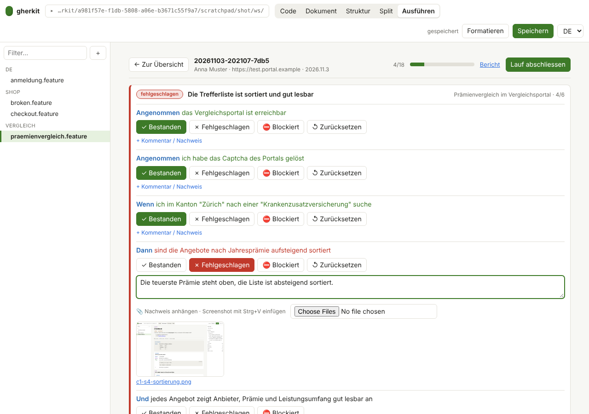

# Manual and hybrid tests

Some acceptance tests are better performed by a person: a price comparison portal behind a captcha, volatile
daily prices, layout and plausibility. gherkit keeps such tests in the same Gherkin files as the automated ones and
records the result in the same format ([ADR 0009](adr/0009-manual-and-hybrid-execution.md)).



## How it works

1. **Mark** the scenario (or the whole feature) with the tag `@manual`. The steps describe what the person does and
   checks. See [`examples/vergleich/praemienvergleich.feature`](../examples/vergleich/praemienvergleich.feature):
   two scenarios are checked automatically through the API, two are tagged `@manual`.
2. **Automated runs skip them.** `gherkit run` passes the tag filter `not @manual` to the runner (change it with
   `--tags`, see [cli.md](cli.md)).
3. **Run by hand** in the editor: open the **Run** tab, enter who tests and on which environment and build, choose the
   scope (only `@manual` test cases, or all) and start. Scenario outlines are already expanded into test cases.
   Per step record *passed*, *failed* or *blocked*, add a comment and evidence (file, or paste a screenshot with
   `Ctrl+V`). Every change is saved at once in `.gherkit/runs/<id>/`, so a run can be interrupted and resumed.
4. **Finish** the run. gherkit writes `.gherkit/runs/<id>/cucumber.json` next to the evidence files.
5. **Report.** The *Report* link of a run opens the standard HTML report (tester, environment, comments, evidence).
   The same file works with the CLI, and merges with the results of the automated run (evidence links in a report
   written elsewhere are relative to the run folder, so keep that report next to it or use the *Report* link):

   ```sh
   gherkit run --report build/auto.html                      # automated scenarios, @manual excluded
   gherkit report build/cucumber.json .gherkit/runs/<id>/cucumber.json -o build/all.html
   gherkit run --cmd "cp .gherkit/runs/<id>/cucumber.json {output}"   # a failed manual step fails the build
   ```

## How results are recorded

| What the person records | In Cucumber JSON |
| --- | --- |
| passed | `passed` |
| failed, comment | `failed`, comment as `error_message` |
| blocked, comment | `skipped`, comment kept; the report marks the step as blocked |
| not processed | `undefined` |

After a failed or blocked step the remaining steps count as `skipped`, unless the person recorded something for them.
Tester, environment, build and times are stored in an additional `gherkit` object that other tools ignore.

## Hybrid tests

Today the mix happens **per scenario**: tag what a person must judge with `@manual` and let the runner do the rest
([ADR 0009](adr/0009-manual-and-hybrid-execution.md), stage 1). Reviewing evidence that automation collected, and a
hand-over inside one scenario, are planned as stages 2 and 3.
