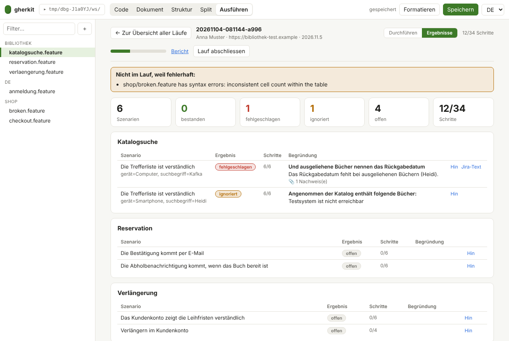

# Manual and hybrid tests

Some acceptance tests are better performed by a person: layout and plausibility, a captcha, a mail that must arrive.
gherkit keeps such tests in the same Gherkin files as the automated ones and records the result in the same format
([ADR 0009](adr/0009-manual-and-hybrid-execution.md)). The standard set has an example: a library where books are
searched, reserved and renewed (`examples/bibliothek`): the API is checked automatically (`@api`), what a person must
judge is tagged `@manual`.


## How it works

1. **Mark** the scenario (or the whole feature) with the tag `@manual`. The steps describe what the person does and
   checks.
2. **Automated runs skip them.** `gherkit run` passes the tag filter `not @manual` to the runner (change it with
   `--tags`, see [cli.md](cli.md)).
3. **Run by hand** in the editor tab **Run**: enter who tests and on which environment and build, choose the scope and
   start. The view guides you through the test cases, feature by feature, scenario by scenario, step by step:
   * the navigation on the left shows every feature and scenario with its state; the header shows the progress;
   * the current step is highlighted. Say **Good**, **Bad** or **Ignore**, and the view moves on by itself;
   * **Bad** and **Ignore** need a reason (what happened? why is the step not judged?). Nothing is saved without it;
   * every step takes **test information** (test data, measured values, observations) and **evidence** (a file, or a
     screenshot pasted with `Ctrl+V`), right in the step;
   * a failed or ignored step ends the scenario; the remaining steps count as skipped;
   * *change* next to a finished step opens it again.
   Every change is saved at once in `.gherkit/runs/<id>/`, so a run can be interrupted and resumed.
4. **Results.** The tab *Results* shows totals and every scenario with its reason, evidence and a link back to it.
   For a failed scenario **Jira text** creates the summary and the description of a bug (observed behaviour, test,
   steps up to the failure, test data, run, evidence files) in Jira wiki format, ready to copy. A tag like
   `@TEST_PROJ-123` (Xray's convention) on the scenario is named as the Xray test.

   
5. **Finish** the run. gherkit writes `.gherkit/runs/<id>/cucumber.json` next to the evidence files.
6. **Report.** The *Report* link of a run opens the standard HTML report (tester, environment, comments, evidence).
   The same file works with the CLI and merges with the results of the automated run (evidence links in a report
   written elsewhere are relative to the run folder, so keep that report next to it or use the *Report* link):

   ```sh
   gherkit run --report build/auto.html                      # automated scenarios, @manual excluded
   gherkit report build/cucumber.json .gherkit/runs/<id>/cucumber.json -o build/all.html
   gherkit run --cmd "cp .gherkit/runs/<id>/cucumber.json {output}"   # a failed manual step fails the build
   ```

## How results are recorded

| What the person says | In Cucumber JSON |
| --- | --- |
| good | `passed` |
| bad, reason | `failed`, reason as `error_message` |
| ignore, reason | `skipped`, reason as `error_message`; the `gherkit` object says `ignored` |
| not processed | `undefined` |

After a failed or ignored step the remaining steps count as `skipped`. Tester, environment, build and times, and the
comment and evidence of each step, are stored in an additional `gherkit` object that other tools ignore.

## The companion window

The Run tab is too big to keep open next to the application under test. **Companion window** (button in the header of
a run) opens a small window that floats above every other window: the current step, the three answers, the comment and
the evidence. It works on the same run as the Run tab, so both always agree; closing it changes nothing.

* Keys: `G` good, `S` bad, `I` ignore (a reason is required for the last two), `←` back, `Esc` cancels.
* Evidence: **Screenshot** asks once which window to share (the application under test), every further click takes a
  picture of it. Or paste a screenshot with Ctrl+V.
* Needs Chrome or Edge 116 or newer for the floating window (Document Picture-in-Picture, page on `localhost` or
  `https`). Other browsers get a normal small window that does not stay in front.
* Not included: jumping to the field in the application under test. The prototypes in
  `prototypes/begleitfenster` (browser extension, controlled browser) show how that could work.

## Trying the companion window

**Online, nothing to install** (the browser demo, https://goerks.github.io/gherkit/editor/; after a release press
Ctrl+F5, and `reset` in the terminal if you have visited before):

1. Tab **Run**, enter a tester, **Start run**.
2. **Companion window**. In Chrome or Edge 116+ a small window floats above all others; open the application under test
   in another window and work through the steps with `G`, `S`, `I`.
3. Check that the Run tab moves along, that bad and ignore need a reason, and that **Results** shows the answers.
4. Not available there: screenshots and attachments (no server).

**With the local editor** (`gherkit edit`, also the Windows download), where evidence is saved with the run:

1. Same steps as above, with a run on the folder of your specifications.
2. Press **Screenshot** in the companion window: the browser asks which window to share; choose the application under
   test. Every further click adds a picture to the current step. Or paste a screenshot with Ctrl+V.
3. After **Finish run**, the pictures are in `.gherkit/runs/<id>/evidence/` and in the report.

What only a person can judge: whether the window really stays in front on your screens (several monitors, full-screen
applications), and how the screen-sharing dialog behaves in your browser and company setup.

## In the browser demo

The demo records, guides and reports like the local editor, and it has the companion window too. It has no
attachments, because its virtual folder holds text only: there is no **Screenshot** button and no pasting of images in
the Run tab and in the companion window.

## What comes next

See the [concept](concepts/manuelle-ausfuehrung.md) (German): variants for the guidance, structured test information
and the connection to Jira and Xray.
